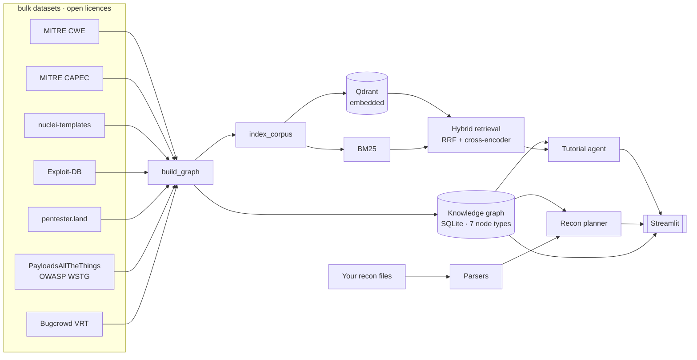

# BountyBrain

A knowledge graph and retrieval system for learning bug bounty hunting.

It answers three questions:

1. **"Explain this vulnerability class"** — a cited explanation grounded in a
   local corpus, never in model memory.
2. **"How does this weakness relate to everything else?"** — a typed, traversable
   graph built on MITRE CWE and CAPEC, not a flat list of labels.
3. **"I ran recon and got this. What should I test next?"** — a ranked, cited
   plan derived from what actually affects the fingerprinted stack.

**BountyBrain never scans anything.** You run recon with your own tools against
targets you are authorised to test; it parses the files you produced and
reasons over a local graph. There is no network egress at query time.

---

## Why the data is bulk-downloaded, not scraped

Every source is a git repository or a single archive published for bulk
consumption, under an open licence. That is a deliberate constraint, and it buys
the thing that matters most for a project whose output is *numbers*:
**anyone can reproduce them.**

```bash
python fetch_data.py && python build_graph.py --rebuild && python eval.py --all
```

A scraped corpus cannot offer that — it decays, it is not redistributable, and
nobody can check your work.

| dataset | licence | what it contributes |
|---|---|---|
| [MITRE CWE](https://cwe.mitre.org/) | MITRE Terms of Use | 969 weakness classes with a real ChildOf/PeerOf/CanPrecede hierarchy |
| [MITRE CAPEC](https://capec.mitre.org/) | MITRE Terms of Use | 615 attack patterns with Explore/Experiment/Exploit execution flows |
| [nuclei-templates](https://github.com/projectdiscovery/nuclei-templates) | MIT | 13,569 detection signatures with CWE/CVSS/EPSS/CPE labels |
| [Exploit-DB](https://gitlab.com/exploit-database/exploitdb) | GPL-2.0 | 46,647 catalogued public exploits |
| [pentester.land](https://pentester.land/) | public JSON feed | 6,421 disclosed writeups with curated labels and bounty amounts |
| [PayloadsAllTheThings](https://github.com/swisskyrepo/PayloadsAllTheThings) | MIT | practitioner technique prose |
| [OWASP WSTG](https://github.com/OWASP/wstg) | CC-BY-SA-4.0 | structured testing methodology |
| [Bugcrowd VRT](https://github.com/bugcrowd/vulnerability-rating-taxonomy) | Apache-2.0 | P1–P5 payout priority, mapped to CWE |

Only **metadata** is taken from pentester.land — a single request to a JSON feed.
The 6,421 linked articles live on ~500 third-party blogs and are never crawled.

---

## The knowledge graph

**111,896 nodes · 96,805 edges · 7 node types · 8 edge types**

| node type | count | | edge type | count |
|---|---:|---|---|---:|
| exploit | 46,647 | | signature → product | 41,248 |
| CVE | 29,971 | | exploit → CVE | 30,347 |
| signature | 13,569 | | document → weakness | 11,403 |
| product | 10,901 | | signature → weakness | 7,309 |
| document | 9,224 | | weakness → CVE (observed) | 3,118 |
| weakness (CWE) | 969 | | weakness → weakness | 1,441 |
| technique (CAPEC) | 615 | | technique → weakness | 1,212 |
| | | | technique → technique | 727 |

Edges are **typed tables, not a generic edge list**, so "which patterns can follow
this one" is a join rather than a string filter.

### Structure

| metric | value |
|---|---|
| density | 1.55 × 10⁻⁵ |
| mean / median / max degree | 1.73 / 1.0 / 3,761 |
| connected components | 46,998 |
| largest component | 35,425 nodes (31.7%) |
| isolated nodes | 24,905 |

The low mean degree and large component count are real and worth stating plainly:
the graph has a dense, well-connected ontological core (CWE ↔ CAPEC ↔ signatures)
surrounded by a long tail of CVE/exploit pairs that connect to nothing else,
because no nuclei template references them. Reporting only the core would flatter
the numbers.

### CWE taxonomy shape

10 pillar roots · 687 leaves · max depth 5 · mean leaf depth 2.58
(299 Variant, 539 Base, 114 Class, 10 Pillar, 7 Compound)

### Coverage — how much is backed by evidence

Size is easy; grounding is not. Of the 969 weakness classes:

| backed by | count | share |
|---|---:|---:|
| an observed CVE | 581 | 60.0% |
| an external document (writeup/article/CAPEC) | 365 | 37.7% |
| a CAPEC attack pattern | 336 | 34.7% |
| a nuclei detection signature | 166 | 17.1% |
| a disclosed bug bounty writeup | 89 | 9.2% |
| a Bugcrowd VRT payout priority | 57 | 5.9% |

> Note: "has *any* document" is 100% by construction — every CWE has its own
> catalogue page in the corpus. That number is excluded above because it measures
> nothing.

### Entity resolution

Bug bounty writeups say "IDOR"; MITRE says *Authorization Bypass Through
User-Controlled Key*. Normalising one vocabulary onto the other is most of the
work in making the graph joinable. The alias table is built from three layers:

1. official CWE names,
2. official `Alternate_Terms`, plus short names hidden in quoted parentheticals
   (`...('Cross-site Scripting')`) and bare ones (`... (CSRF)`),
3. a hand-curated layer of ~110 community terms MITRE does not carry at all
   (IDOR, SSTI, account takeover, subdomain takeover, WAF bypass, …).

**1,337 aliases** resolve onto 969 classes. Applied to pentester.land's 671
distinct curated labels, this maps **93.1%** of vulnerability-labelled writeups
onto the ontology (up from 76.5% before the parenthetical and curated layers).

The remaining ~7% is a genuine long tail. Separately, 22 labels are *not
vulnerability classes at all* — "Android", "Cloud", "AI", "Security code review"
are platform and engagement tags. Those are excluded from the denominator rather
than force-mapped onto some vaguely related CWE, which would be fabrication.

A test asserts every curated alias points at a weakness that actually exists —
it caught six entries pointing at CWE-840 and CWE-16, which are *categories*,
not weaknesses, and would have produced dangling edges.

---

## Evaluation

Three suites, each designed so the result could come out badly.

### 1. Retrieval — a four-way ablation

Claiming "we use hybrid search" means nothing without showing it beats its parts,
so all four arms run over identical queries and an identical corpus.

Queries are **model-generated from held-out passages**, with an explicit
instruction not to reuse distinctive tokens from the source. This matters: if
queries copy rare strings, BM25 wins by construction and the comparison is
worthless. The generated set is committed to `bountybrain/fixtures/` so the
numbers are reproducible and the queries can be inspected by hand.

Relevance is known-item: a hit counts only if it comes from the document the
query was generated from. That under-counts genuinely relevant results from other
documents, so absolute recall is a **lower bound** — but it is applied identically
to every arm, so the comparison stands.

<!-- RETRIEVAL_TABLE -->

### 2. CWE classification — against two independent gold sets

Agreeing with one labeller could be an artefact of that labeller's conventions,
so two are used: nuclei's community-assigned `cwe-id` (~7k templates) and
pentester.land's curated labels (~6.4k writeups). Nothing in the keyword table,
the embedding index, or the prompt was tuned against either.

Three strategies, same inputs:

- **keyword** — longest-alias lookup. No model, no GPU.
- **embedding** — nearest CWE by vector similarity.
- **llm** — retrieval-augmented: shortlist by embedding, then the model picks
  from the shortlist. It never chooses freely from all 969 classes; anything
  off the shortlist is rejected, which makes hallucinated CWE ids structurally
  impossible rather than merely unlikely.

Alongside exact accuracy, a **hierarchy-aware** score gives credit when the
prediction is within two hops of the gold class on the ChildOf tree — predicting
CWE-79 where gold says CWE-80 (its child) is a different kind of error from
predicting CWE-89. **Abstention rate** is reported because a classifier that
declines often can post good accuracy on whatever remains.

<!-- CLASSIFICATION_TABLE -->

### 3. Recon planner — next-move ranking

Given a fingerprinted technology, rank the weakness classes worth testing. Gold
is a **held-out** nuclei template for that product.

The subtle part: the gold label *is* a signature→weakness edge, and the planner
scores using signature→weakness edges. Grade it naively and you measure nothing.
So 20% of each product's templates are held out and **excluded from the evidence
pool** — the planner has to generalise from the rest of the stack.

Two baselines, because a ranking number without one is uninterpretable:
`random` shuffles the same candidate pool, and `prior` ranks by global class
frequency, ignoring the fingerprint entirely. **Beating `prior` is the real bar** —
it is what shows the model uses the recon input rather than the base rate of XSS
being common.

**400 held-out cases across 147 products:**

| strategy | P@1 | P@3 | P@5 | MRR |
|---|---:|---:|---:|---:|
| planner (value-weighted) | **0.427** | 0.562 | 0.650 | 0.517 |
| planner (likelihood-only) | 0.422 | **0.570** | **0.662** | **0.522** |
| prior (global frequency) | 0.325 | 0.532 | 0.598 | 0.445 |
| random | 0.095 | 0.282 | 0.440 | 0.245 |

Two things worth reading off that table.

**The first version of this scorer lost to the prior** (P@1 0.280 vs 0.325). Its
applicability term was a log-scaled count of matching templates, which saturates
at 1.0 for any popular product — every ranking was then decided by
stack-independent terms, badly. Replacing it with a smoothed conditional
estimate, P(weakness | product), shrunk toward the global prior by a
pseudo-count, took P@1 from 0.280 to 0.427.

**Value weighting costs a little ranking accuracy** (P@3 0.562 vs 0.570), and it
should: ranking by what a stack is most likely to expose is a different question
from ranking by what is worth your afternoon. Both are exposed in the UI, and
reporting only the flattering one would hide a real trade-off.

---

## How the recon planner scores

For each weakness class applicable to a fingerprinted stack, four signals:

| signal | source | question |
|---|---|---|
| **applicability** | nuclei templates on this product | given this stack, how much of its known weakness surface is this class? |
| **exploitability** | EPSS, else CWE likelihood-of-exploit | how likely is real-world exploitation? |
| **weaponisation** | Exploit-DB | does public working exploit code exist? |
| **economics** | disclosed bounties + Bugcrowd VRT | what has this class actually paid? |

Applicability carries the most weight (0.55) because it is the only term
conditioned on the actual stack; the others describe a class in general and would
otherwise re-derive a global popularity ranking. Weights are heuristics, stated
explicitly in `ScoringWeights`, and the evaluation above measures whether they
work.

Output is not a list of nouns. For each recommended class the planner pulls the
matching CAPEC **execution flow** and surfaces its Explore and Experiment steps,
each linked back to the pattern it came from, alongside the detection templates
to run and the best-paying prior disclosures.

---

## Architecture



### Layout

```
bountybrain/
  datasets/    one parser per source + the licensed manifest
  kg/          SQLAlchemy models, graph builder, metrics
  rag/         chunker, index builder, hybrid retrieval
  recon/       recon-file parsers + the planner
  eval/        retrieval, classification, planner suites
  agent/       tutorial generation tools
  ui/          Streamlit pages
  clients/     LLM, embeddings, vector store
prompts/       every prompt, loaded from file — never inlined in code
fetch_data.py  download datasets
build_graph.py parse -> graph + metrics
index_corpus.py chunk + embed
serve_llm.py   local vLLM server
eval.py        run the suites
```

---

## Running it

Full setup, including shared-GPU-server caveats, is in [SETUP.md](SETUP.md).

```bash
mamba create -n bountybrain python=3.11 -y && conda activate bountybrain
pip install vllm && pip install -r requirements.txt

python fetch_data.py            # ~1 GB, bulk downloads only
python build_graph.py --rebuild # graph + metrics
python index_corpus.py          # chunk + embed
streamlit run bountybrain/ui/streamlit_app.py
```

Steps 1–3 need **no GPU and no LLM**. The graph, the planner, the Explore and
Metrics pages, and the keyword/embedding classification arms all work without one.

For generated tutorials and the LLM evaluation arms:

```bash
python serve_llm.py             # picks a free GPU; local vLLM, nothing leaves the host
python eval.py --all
```

### Design decisions worth knowing

- **SQLite by default.** The graph is ~150 MB and needs no server, so
  `git clone && python build_graph.py` reproduces the published metrics anywhere.
  Point `DATABASE_URL` at Postgres if you want concurrent writers.
- **Qdrant embedded by default.** No server, no port to collide with on a shared
  machine. It takes an exclusive lock on `data/qdrant`, so the UI and an eval run
  cannot both hold it — run one at a time, or set `QDRANT_URL`.
- **Structure-aware chunking.** Fenced code blocks are never split. In this corpus
  a payload *is* the answer, and half a payload retrieves as noise and reads as
  garbage when cited.
- **Asymmetric embeddings.** BGE wants an instruction prefix on queries but not
  passages, so `embed_query` and `embed_passages` are separate calls.
- **No web search.** An earlier version had a Brave-backed search tool that
  silently returned nothing without an API key — worse than absent, because the
  agent would claim to have searched and ground its answer in nothing. It was
  removed rather than left as a stub.

---

## Tests

```bash
pytest          # 29 tests, no network, no GPU, no downloads
```

They cover the invariants that actually bite: code fences surviving chunking,
chunks never becoming subsets of one another, ExploitDB's ~460 duplicate ids,
coverage arithmetic excluding non-vulnerability labels, and every curated CWE
alias pointing at a weakness that exists.

## Licence

MIT for this code. Bundled datasets keep their own licences — see the table above
and `bountybrain/datasets/registry.py`, which records licence and attribution per
source.
