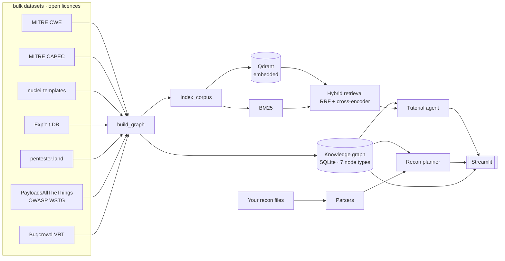

# BountyBrain

A knowledge graph and retrieval system for learning bug bounty hunting.

It answers four questions:

1. **"Where do I start?"** — a learning path for one vulnerability class:
   the weakness, the attack patterns that exploit it (easiest first), real
   disclosed reports, labs to practise in, and what it leads to next — each
   step an edge in the graph.
2. **"Explain this vulnerability class"** — an explanation generated from
   passages retrieved from a local corpus, citing them by number. How far the
   citations hold is measured, not assumed: 32.6% of sentences are cited *and*
   supported by their source, and 45% cite nothing (see Evaluation §4).
3. **"How does this weakness relate to everything else?"** — a typed, traversable
   graph built on MITRE CWE and CAPEC, not a flat list of labels.
4. **"I ran recon and got this. What should I test next?"** — a ranked, cited
   plan derived from what actually affects the fingerprinted stack.

**BountyBrain never scans anything.** You run recon with your own tools against
targets you are authorised to test; it parses the files you produced and
reasons over a local graph. There is no network egress at query time.

> **Docs:** [RESULTS.md](RESULTS.md) — every metric, with caveats and the bugs
> the evaluations caught · [PROGRESS.md](PROGRESS.md) — current state and what
> to do next · [SETUP.md](SETUP.md) — environment, including four vLLM traps ·
> [ATTRIBUTION.md](ATTRIBUTION.md) — dataset licences.

---

## Why the data is bulk-downloaded, not scraped

Every source is a git repository or a single archive published for bulk
consumption, under an open licence. That is a deliberate constraint, and it buys
the thing that matters most for a project whose output is *numbers*:
**anyone can reproduce them.**

```bash
python fetch_data.py && python build_graph.py --rebuild && python eval.py --all
```

A scraped corpus cannot offer that — it decays, it is not redistributable, and
nobody can check your work.

| dataset | licence | what it contributes |
|---|---|---|
| [MITRE CWE](https://cwe.mitre.org/) | MITRE Terms of Use | 969 weakness classes with a real ChildOf/PeerOf/CanPrecede hierarchy |
| [MITRE CAPEC](https://capec.mitre.org/) | MITRE Terms of Use | 615 attack patterns with Explore/Experiment/Exploit execution flows |
| [nuclei-templates](https://github.com/projectdiscovery/nuclei-templates) | MIT | 13,569 detection signatures with CWE/CVSS/EPSS/CPE labels |
| [Exploit-DB](https://gitlab.com/exploit-database/exploitdb) | GPL-2.0 | 46,647 catalogued public exploits |
| [pentester.land](https://pentester.land/) | public JSON feed | 6,421 disclosed writeups with curated labels and bounty amounts |
| [PayloadsAllTheThings](https://github.com/swisskyrepo/PayloadsAllTheThings) | MIT | practitioner technique prose |
| [OWASP WSTG](https://github.com/OWASP/wstg) | CC-BY-SA-4.0 | structured testing methodology |
| [Bugcrowd VRT](https://github.com/bugcrowd/vulnerability-rating-taxonomy) | Apache-2.0 | P1–P5 payout priority, mapped to CWE |

Only **metadata** is taken from pentester.land — a single request to a JSON feed.
The 6,421 linked articles live on ~500 third-party blogs and are never crawled.

---

## The knowledge graph

**111,896 nodes · 96,805 edges · 7 node types · 8 edge types**

| node type | count | | edge type | count |
|---|---:|---|---|---:|
| exploit | 46,647 | | signature → product | 41,248 |
| CVE | 29,971 | | exploit → CVE | 30,347 |
| signature | 13,569 | | document → weakness | 11,403 |
| product | 10,901 | | signature → weakness | 7,309 |
| document | 9,224 | | weakness → CVE (observed) | 3,118 |
| weakness (CWE) | 969 | | weakness → weakness | 1,441 |
| technique (CAPEC) | 615 | | technique → weakness | 1,212 |
| | | | technique → technique | 727 |

Edges are **typed tables, not a generic edge list**, so "which patterns can follow
this one" is a join rather than a string filter.

### Structure

| metric | value |
|---|---|
| density | 1.55 × 10⁻⁵ |
| mean / median / max degree | 1.73 / 1.0 / 3,761 |
| connected components | 46,998 |
| largest component | 35,425 nodes (31.7%) |
| isolated nodes | 24,905 |

The low mean degree and large component count are real and worth stating plainly:
the graph has a dense, well-connected ontological core (CWE ↔ CAPEC ↔ signatures)
surrounded by a long tail of CVE/exploit pairs that connect to nothing else,
because no nuclei template references them. Reporting only the core would flatter
the numbers.

Dropping that tail makes the shape explicit — the core is **35,278 nodes and
63,340 edges**, a mean degree of 3.59 rather than 1.73, with a largest
component of 32,457 nodes (`core_structure` in `artifacts/graph_metrics.json`):

```bash
python export_graph.py --format both --core-only   # GraphML + node/edge CSV
```

### CWE taxonomy shape

10 pillar roots · 687 leaves · max depth 5 · mean leaf depth 2.58
(299 Variant, 539 Base, 114 Class, 10 Pillar, 7 Compound)

### Coverage — how much is backed by evidence

Size is easy; grounding is not. Of the 969 weakness classes:

| backed by | count | share |
|---|---:|---:|
| an observed CVE | 581 | 60.0% |
| an external document (writeup/article/CAPEC) | 365 | 37.7% |
| a CAPEC attack pattern | 336 | 34.7% |
| a nuclei detection signature | 166 | 17.1% |
| a disclosed bug bounty writeup | 89 | 9.2% |
| a Bugcrowd VRT payout priority | 57 | 5.9% |

> Note: "has *any* document" is 100% by construction — every CWE has its own
> catalogue page in the corpus. That number is excluded above because it measures
> nothing.

### Entity resolution

Bug bounty writeups say "IDOR"; MITRE says *Authorization Bypass Through
User-Controlled Key*. Normalising one vocabulary onto the other is most of the
work in making the graph joinable. The alias table is built from three layers:

1. official CWE names,
2. official `Alternate_Terms`, plus short names hidden in quoted parentheticals
   (`...('Cross-site Scripting')`) and bare ones (`... (CSRF)`),
3. a hand-curated layer of 109 community terms MITRE does not carry at all
   (IDOR, SSTI, account takeover, subdomain takeover, WAF bypass, …).

**1,389 aliases** resolve onto 969 classes. Applied to pentester.land's 671
distinct curated labels, this maps **93.1%** of vulnerability-labelled writeups
onto the ontology (up from 76.5% before the parenthetical and curated layers).

The remaining ~7% is a genuine long tail. Separately, 22 labels are *not
vulnerability classes at all* — "Android", "Cloud", "AI", "Security code review"
are platform and engagement tags. Those are excluded from the denominator rather
than force-mapped onto some vaguely related CWE, which would be fabrication.

A test asserts every curated alias points at a weakness that actually exists —
it caught six entries pointing at CWE-840 and CWE-16, which are *categories*,
not weaknesses, and would have produced dangling edges.

---

## Evaluation

Five suites, each designed so the result could come out badly, plus an
end-to-end run of the API and every UI page against the real graph and model
(`e2e.py` → `artifacts/e2e.json`: 13/13 API routes, 7/7 pages, live server 2/2).

### 1. Retrieval — a four-way ablation

Claiming "we use hybrid search" means nothing without showing it beats its parts,
so all four arms run over identical queries and an identical corpus.

Queries are **model-generated from held-out passages**, with an explicit
instruction not to reuse distinctive tokens from the source. This matters: if
queries copy rare strings, BM25 wins by construction and the comparison is
worthless. The generated set is committed to `bountybrain/fixtures/` so the
numbers are reproducible and the queries can be inspected by hand.

Relevance is known-item: a hit counts only if it comes from the document the
query was generated from. That under-counts genuinely relevant results from other
documents, so absolute recall is a **lower bound** — but it is applied identically
to every arm, so the comparison stands.

<!-- RETRIEVAL_TABLE -->

**200 held-out queries.** Higher is better; latency is per query on one GPU.

| mode | R@1 | R@5 | R@10 | MRR | nDCG@10 | median ms |
|---|---:|---:|---:|---:|---:|---:|
| dense (embeddings only) | 0.665 | 0.885 | 0.925 | 0.759 | 0.791 | 39 |
| BM25 (lexical only) | 0.655 | 0.850 | 0.890 | 0.735 | 0.764 | 16 |
| hybrid (RRF fusion) | 0.675 | 0.910 | 0.955 | 0.773 | 0.809 | 56 |
| **hybrid + cross-encoder rerank** | **0.800** | **0.965** | **0.975** | **0.861** | **0.873** | 154 |

Per document type (hybrid_rerank):

| document type | n | R@5 | MRR |
|---|---:|---:|---:|
| article | 50 | 0.940 | 0.794 |
| technique | 50 | 0.980 | 0.881 |
| weakness | 50 | 0.940 | 0.819 |
| writeup | 50 | 1.000 | 0.952 |

<!-- /RETRIEVAL_TABLE -->

### 2. CWE classification — against two independent gold sets

Agreeing with one labeller could be an artefact of that labeller's conventions,
so two are used: nuclei's community-assigned `cwe-id` (~7k templates) and
pentester.land's curated labels (~6.4k writeups). Nothing in the keyword table,
the embedding index, or the prompt was tuned against either.

Three strategies, same inputs:

- **keyword** — longest-alias lookup. No model, no GPU.
- **embedding** — nearest CWE by vector similarity.
- **llm** — retrieval-augmented: shortlist by embedding, then the model picks
  from the shortlist. It never chooses freely from all 969 classes; anything
  off the shortlist is rejected, which makes hallucinated CWE ids structurally
  impossible rather than merely unlikely.

Alongside exact accuracy, a **hierarchy-aware** score gives credit when the
prediction is within two hops of the gold class on the ChildOf tree — predicting
CWE-79 where gold says CWE-80 (its child) is a different kind of error from
predicting CWE-89. **Abstention rate** is reported because a classifier that
declines often can post good accuracy on whatever remains.

<!-- CLASSIFICATION_TABLE -->

**Gold set: nuclei templates (name + description + impact)**

| strategy | n | accuracy | hierarchy ±2 | macro F1 | abstained |
|---|---:|---:|---:|---:|---:|
| keyword | 500 | 0.398 | 0.444 | 0.216 | 0.354 |
| embedding | 500 | 0.210 | 0.314 | 0.050 | 0.000 |
| llm | 500 | 0.374 | 0.456 | 0.105 | 0.290 |
| **keyword→llm** | 500 | **0.404** | 0.452 | 0.165 | 0.276 |

**Gold set: disclosed writeups (title only — a harder task)**

| strategy | n | accuracy | hierarchy ±2 | macro F1 | abstained |
|---|---:|---:|---:|---:|---:|
| keyword | 500 | 0.402 | 0.426 | 0.299 | 0.524 |
| embedding | 500 | 0.330 | 0.412 | 0.102 | 0.000 |
| llm | 500 | 0.364 | 0.416 | 0.168 | 0.356 |
| **keyword→llm** | 500 | **0.474** | 0.526 | 0.233 | 0.288 |

**Embedding shortlist recall** — is the gold class among the top-k candidates at all? The LLM chooses from the top 12, so recall@12 caps its accuracy.

| gold set | R@1 | R@5 | R@12 | R@20 | R@50 | hierarchy ±2 R@12 |
|---|---:|---:|---:|---:|---:|---:|
| nuclei | 0.210 | 0.372 | 0.450 | 0.508 | 0.622 | 0.618 |
| pentesterland | 0.330 | 0.464 | 0.530 | 0.558 | 0.622 | 0.652 |

**LLM accuracy, split by whether gold was on its shortlist**

| gold set | gold on shortlist: n | accuracy | gold not on shortlist: n | accuracy |
|---|---:|---:|---:|---:|
| nuclei | 225 | 0.831 | 275 | 0.000 |
| pentesterland | 265 | 0.687 | 235 | 0.000 |

<!-- /CLASSIFICATION_TABLE -->

A fourth row needs no extra model calls: **keyword→llm** uses the alias table
when it fires and asks the LLM only when keyword abstains.

**The retrieval-augmented LLM classifier still does not beat the keyword
alias table — now on a fair comparison.** An earlier run was confounded: the
curated community aliases (IDOR, SSTI, …) reached the keyword baseline but
were never stored in the graph, so the embedding and LLM arms, which shortlist
from the stored aliases, never saw them. With the aliases persisted and the
candidate index rebuilt, on the same 500 items per set:

- On **nuclei** the fix changed almost nothing (LLM 0.368 → 0.374, keyword
  0.398). Template prose rarely uses the slang.
- On **writeup titles** it closed most of the gap (LLM 0.280 → 0.364,
  embedding 0.188 → 0.330, keyword 0.402) — the confound hurt exactly where
  practitioner slang dominates.

**The shortlist, not the model, is the ceiling.** The gold class is among the
12 candidates the LLM sees only 45% (nuclei) / 53% (titles) of the time; when
it is, the LLM picks it 83% / 69% of the time, and it scores zero otherwise by
construction. Fixing retrieval of candidate classes is worth more than a
better model.

**Routing beats both.** keyword→llm reaches 0.404 on nuclei (+0.006 over
keyword, within noise) and 0.474 on titles (+0.072). The titles number
carries the caveat below.

One caveat limits the *writeup* comparison specifically: that set's gold labels
come from applying the alias table to the curated `Bugs` field, while the
keyword baseline searches the title using the same table. The inputs differ, so
it is not straightforwardly circular, but the shared vocabulary hands the
keyword arm free wins whenever a title happens to name the bug. **The nuclei
set is the fair comparison**, and there keyword and LLM are close.

The practical consequence: keyword is the right default for bulk CWE
assignment here — faster, free, and at least as accurate. The LLM earns its
place generating cited prose, which the faithfulness numbers below measure.

### 3. Recon planner — next-move ranking

Given a fingerprinted technology, rank the weakness classes worth testing. Gold
is a **held-out** nuclei template for that product.

The subtle part: the gold label *is* a signature→weakness edge, and the planner
scores using signature→weakness edges. Grade it naively and you measure nothing.
So 20% of each product's templates are held out and **excluded from the evidence
pool** — the planner has to generalise from the rest of the stack.

Two baselines, because a ranking number without one is uninterpretable:
`random` shuffles the same candidate pool, and `prior` ranks by global class
frequency, ignoring the fingerprint entirely. **Beating `prior` is the real bar** —
it is what shows the model uses the recon input rather than the base rate of XSS
being common.

**400 held-out cases across 147 products:**

| strategy | P@1 | P@3 | P@5 | MRR |
|---|---:|---:|---:|---:|
| planner (value-weighted) | **0.427** | 0.562 | 0.650 | 0.517 |
| planner (likelihood-only) | 0.422 | **0.570** | **0.662** | **0.522** |
| prior (global frequency) | 0.325 | 0.532 | 0.598 | 0.445 |
| random | 0.095 | 0.282 | 0.440 | 0.245 |

Two things worth reading off that table.

**The first version of this scorer lost to the prior** (P@1 0.280 vs 0.325). Its
applicability term was a log-scaled count of matching templates, which saturates
at 1.0 for any popular product — every ranking was then decided by
stack-independent terms, badly. Replacing it with a smoothed conditional
estimate, P(weakness | product), shrunk toward the global prior by a
pseudo-count, took P@1 from 0.280 to 0.427.

**Value weighting costs a little ranking accuracy** (P@3 0.562 vs 0.570), and it
should: ranking by what a stack is most likely to expose is a different question
from ranking by what is worth your afternoon. Both are exposed in the UI, and
reporting only the flattering one would hide a real trade-off.

### 4. Tutorial faithfulness — are the citations real?

The Learn page promises an explanation where every claim is cited to a
retrieved passage. This suite checks that promise on 30 fixed topics, through
the page's own code path. Each tutorial is split into sentences without a
model; each sentence's `[n]` markers are checked against the sources it was
given (a number that points at nothing is a hallucinated citation, checkable
exactly); and an LLM judge reads the cited excerpts — truncated exactly as the
generator saw them — and labels the sentence supported, partial or
unsupported. The judge is the generator's own model, so it is calibrated
against blind hand labels rather than trusted.

<!-- FAITHFULNESS_TABLE -->

**30 fixed topics, 424 generated sentences** (baseline prompt: 530). Same retrieval and model; only the tutorial prompt differs.

| | baseline prompt | current prompt |
|---|---:|---:|
| sentences carrying a citation | 13.2% | 54.5% |
| citation numbers that point at no source | 0.0% | 0.0% |
| cited sentences the judge calls supported | 15.7% | 42.4% |
| cited sentences the judge calls unsupported | 22.9% | 9.1% |
| cited sentences supported, hand-calibrated | 38.6% | 59.7% |
| **all sentences cited *and* supported, hand-calibrated** | 5.1% | **32.6%** |

**LLM judge vs blind hand labels** (40 sentences per prompt, stratified on the judge's verdict)

| claims from | agreement (3-way) | Cohen's κ | agreement (supported or not) | κ |
|---|---:|---:|---:|---:|
| baseline prompt | 0.600 | 0.42 | 0.725 | 0.41 |
| current prompt | 0.825 | 0.71 | 0.875 | 0.75 |

<!-- /FAITHFULNESS_TABLE -->

**The first measurement was bad, and it is kept.** With the original prompt,
13% of sentences carried a citation and roughly one sentence in twenty was
both cited and supported. Two causes were visible in the outputs: the
knowledge-graph facts were given "for framing" with no number, so the model
used them uncited (one SSRF tutorial pinned the class's top bounty, $288,500,
onto an unrelated example); and the citation rules sat above ~7k characters of
sources. The current prompt makes the graph summary the last numbered source
and puts the rules, with an example, after the sources. It was tuned on 10
separate dev topics and the 30 test topics were run once.

**What is still wrong.** Under half the sentences cite anything. The judge's
"partial" is a catch-all — on hand review it hides both supported and
unsupported sentences — and half of the hand-unsupported sentences are safety
reminders the model still tags with a source number despite being told not to.
The hand labels were made by Claude, blind to the judge's verdicts; they and
the notes behind each are in `bountybrain/fixtures/faithfulness_handcheck*.json`.

### 5. Learning path completeness

The Learning Path page orders one class's study plan from graph edges:
weakness → attack patterns (lowest required skill first) → disclosed writeups
→ practice labs → what to learn next. When a stage is empty it borrows from a
parent or child class and says which. How often the graph can fill it:

<!-- LEARNING_PATH_TABLE -->

| population | n | complete path | complete, no borrowing | patterns | writeups | labs |
|---|---:|---:|---:|---:|---:|---:|
| learner topics | 29 | 86.2% | 69.0% | 96.5% | 100.0% | 89.7% |
| all CWE classes | 969 | 16.2% | 2.5% | 66.7% | 31.2% | 16.4% |

Unresolved topic: NoSQL injection. Incomplete: Subdomain takeover, Clickjacking, Mass assignment, CRLF injection.

<!-- /LEARNING_PATH_TABLE -->

For the topics a learner actually asks about the path is usually complete;
across the whole catalogue it rarely is, because most CWE classes have no
disclosed writeup and no curated lab. Borrowing is shown, never hidden.

---

## How the recon planner scores

For each weakness class applicable to a fingerprinted stack, four signals:

| signal | source | question |
|---|---|---|
| **applicability** | nuclei templates on this product | given this stack, how much of its known weakness surface is this class? |
| **exploitability** | EPSS, else CWE likelihood-of-exploit | how likely is real-world exploitation? |
| **weaponisation** | Exploit-DB | does public working exploit code exist? |
| **economics** | disclosed bounties + Bugcrowd VRT | what has this class actually paid? |

Applicability carries the most weight (0.55) because it is the only term
conditioned on the actual stack; the others describe a class in general and would
otherwise re-derive a global popularity ranking. Weights are heuristics, stated
explicitly in `ScoringWeights`, and the evaluation above measures whether they
work.

Output is not a list of nouns. For each recommended class the planner pulls the
matching CAPEC **execution flow** and surfaces its Explore and Experiment steps,
each linked back to the pattern it came from, alongside the detection templates
to run and the best-paying prior disclosures.

---

## What the UI does

Six Streamlit pages, all reading the same local graph.

| page | what it answers |
|---|---|
| **Learning Path** | "Where do I start?" An ordered plan for one class — the weakness, the attack patterns that exploit it (easiest first), real disclosures, labs to practise in, and what it leads to next — every step an edge in the graph. |
| **Learn** | "Explain this class." A cited tutorial grounded in retrieved passages, with the sources listed under the same numbers it cites them by, the CAPEC patterns that exploit it, the real disclosures, and where to go practise it. Each disclosure expands to show **other reports connected to it** — same weakness class found elsewhere, or the same program yielding a different bug. |
| **Explore** | "How does this relate to everything else?" Parents, children, peers and chaining edges in the CWE taxonomy, plus every attack pattern and disclosed writeup attached to the class. |
| **Attack Chains** | "What does this bug let me do next?" Walks CAPEC's chaining edges to turn isolated patterns into multi-step routes. |
| **Recon Planner** | "I ran recon — what now?" A ranked, cited plan per host, **and the disclosed reports matching that fingerprint**: reports labelled with a ranked weakness class *and* naming a technology the asset actually runs are surfaced first, because those describe the bug class on this stack rather than in general. |
| **Metrics** | The evaluation numbers, read from `artifacts/`. |

Practice-lab lookup resolves through the graph rather than by string match, so
"IDOR", "Insecure Direct Object Reference" and "CWE-639" all land on the same
entry, and a class with no lab of its own inherits its parent's.

---

## Architecture



### Layout

```
bountybrain/
  datasets/    one parser per source + the licensed manifest
  kg/          SQLAlchemy models, graph builder, metrics
  rag/         chunker, index builder, hybrid retrieval
  recon/       recon-file parsers + the planner
  eval/        retrieval, classification, planner, faithfulness, learning-path suites
  agent/       tutorial generation tools, the learning path
  ui/          Streamlit pages
  clients/     LLM, embeddings, vector store
prompts/        every prompt, loaded from file — never inlined in code
examples/       synthetic recon files + a generated sample plan
artifacts/      metrics and eval results as JSON (committed — the evidence
                behind every number in this README)

fetch_data.py   download the datasets
build_graph.py  parse -> knowledge graph + metrics
index_corpus.py chunk + embed -> vector store
serve_llm.py    start a local vLLM server on a free GPU
eval.py         run the evaluation suites
e2e.py          drive the API and every UI page against the real graph and model
report.py       render eval tables into this README
export_graph.py GraphML / CSV export for Gephi, Neo4j, pandas
```

---

## Running it

Full setup, including shared-GPU-server caveats, is in [SETUP.md](SETUP.md).

```bash
mamba create --name bountybrain python=3.11 -y && mamba activate bountybrain
pip install vllm==0.27.1 && pip install -r requirements.txt   # vLLM first: it pins torch

python fetch_data.py            # ~1 GB, bulk downloads only
python build_graph.py --rebuild # graph + metrics
python index_corpus.py          # chunk + embed
streamlit run bountybrain/ui/streamlit_app.py
```

Steps 1–3 need **no GPU and no LLM**. The graph, the planner, the Explore and
Metrics pages, and the keyword/embedding classification arms all work without one.

For generated tutorials and the LLM evaluation arms:

```bash
python serve_llm.py             # picks a free GPU; local vLLM, nothing leaves the host
python eval.py --all
uvicorn bountybrain.api.app:app --port 8765 &   # API; /docs lists every route
python e2e.py --api http://localhost:8765       # then stop the API (Qdrant lock)
python e2e.py --ui                              # every page, real model
```

### Environment this was last run in (2026-10-22)

| | |
|---|---|
| mamba env | `bountybrain` |
| Python | 3.11.17 |
| torch | 2.13.0+cu130 |
| vllm | 0.27.1 (`--enforce-eager` + the flashinfer patch in SETUP.md, both still required) |
| flashinfer-python | 0.6.16.post3 |
| transformers | 5.20.2 |
| sentence-transformers | 6.2.0 |
| xgrammar | 0.2.8 |
| streamlit | 1.66.1 |
| fastapi / uvicorn | 0.136.3 / 0.54.0 |
| qdrant-client | 1.20.0 |
| SQLAlchemy | 2.1.6 |
| networkx | 3.6.1 |
| numpy / pandas | 2.3.5 / 3.0.6 |
| openai (client) | 3.36.1 |
| pytest / ruff | 9.1.1 / 0.17.1 |

Model: `Qwen/Qwen2.5-14B-Instruct` on one H100-class GPU at 40% memory;
embeddings `BAAI/bge-small-en-v1.5`, reranker `BAAI/bge-reranker-base`.
A full record (`environment.yml`, exact builds, `pip freeze`) is in the
user's env registry; `pip check` reports no broken requirements.

### Design decisions worth knowing

- **SQLite by default.** The graph is ~40 MB and needs no server, so
  `git clone && python build_graph.py` reproduces the published metrics anywhere.
  Point `DATABASE_URL` at Postgres if you want concurrent writers.
- **Qdrant embedded by default.** No server, no port to collide with on a shared
  machine. It takes an exclusive lock on `data/qdrant`, so the UI and an eval run
  cannot both hold it — run one at a time, or set `QDRANT_URL`.
- **Structure-aware chunking.** Fenced code blocks are never split. In this corpus
  a payload *is* the answer, and half a payload retrieves as noise and reads as
  garbage when cited.
- **Asymmetric embeddings.** BGE wants an instruction prefix on queries but not
  passages, so `embed_query` and `embed_passages` are separate calls.
- **No web search.** An earlier version had a Brave-backed search tool that
  silently returned nothing without an API key — worse than absent, because the
  agent would claim to have searched and ground its answer in nothing. It was
  removed rather than left as a stub.

---

## Tests

```bash
pytest          # 84 tests, no network, no GPU, no downloads
```

They cover the invariants that actually bite: code fences surviving chunking,
chunks never becoming subsets of one another, ExploitDB's ~460 duplicate ids,
coverage arithmetic excluding non-vulnerability labels, every curated CWE
alias pointing at a weakness that exists, and an exact alias winning over a
more specific name match ("SQL injection" is CWE-89, not the Hibernate
variant). `tests/test_app_smoke.py` renders every Streamlit page with
`streamlit.testing` and calls every API route, against a small fixture graph
with retrieval and the model stubbed, so a page that crashes on render fails
CI. The real-stack run is `e2e.py`.

## Licence

MIT for this code. Bundled datasets keep their own licences — see the table above
and `bountybrain/datasets/registry.py`, which records licence and attribution per
source.
