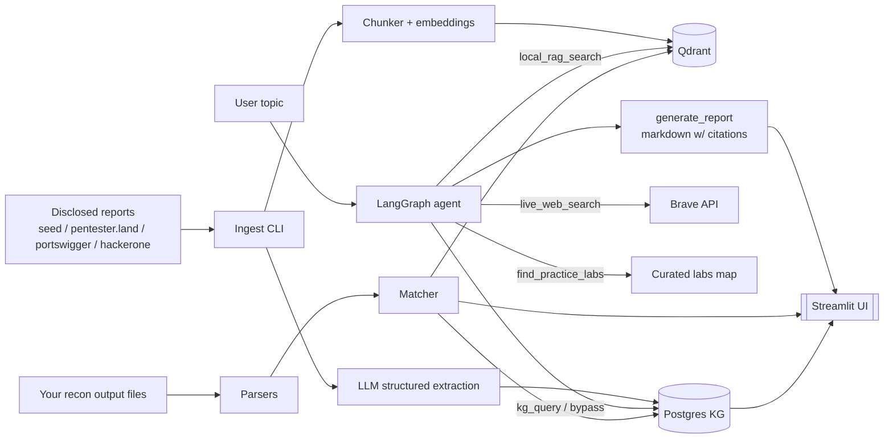

# BountyBrain

A research assistant for people **learning** bug bounty hunting. It combines:

- a Retrieval-Augmented Generation (RAG) layer over disclosed reports,
- a knowledge graph of vulnerabilities, techniques, tools, targets, and CVEs,
- an agent that produces beginner-friendly tutorials with citations,
- and a matcher that takes your own recon-tool output files and finds
  related disclosed reports.

**BountyBrain does not run scanning of any kind.** You run recon with
your own tools; BountyBrain only parses the files you upload.

---

## Architecture



## Repo layout

```
bountybrain/
  agent/       LangGraph state machine + tool wrappers
  api/         FastAPI wrapper
  clients/     LLM / embeddings / Qdrant client stubs
  eval/        retrieval, extraction, faithfulness eval scripts
  fixtures/    hand-built eval sets
  ingestion/   source fetchers + chunker + extractor + pipeline
  kg/          SQLAlchemy models + queries
  rag/         hybrid search (dense + BM25 + rerank)
  recon/       parsers + matcher for recon tool output
  seed/        bundled synthetic seed corpus (60 reports)
  ui/          Streamlit multi-page app
  web/         live web search (Brave)
prompts/       all LLM prompts (loaded from files)
scripts/       build_seed_corpus.py
tests/         pytest
docker/        Dockerfiles
ingest.py      CLI: `python ingest.py --source seed`
demo.py        three end-to-end example queries
eval.py        run all three eval suites -> eval_results.json
```

## Setup

Prereqs: Python 3.11+, Docker (only if you want Postgres + Qdrant containers).

```bash
git clone <this-repo> bountybrain && cd bountybrain
cp .env.example .env               # edit if you want to swap providers
pip install -r requirements.txt
```

### Zero-config run (SQLite + no LLM)

Works fully offline. Postgres is auto-replaced with a local SQLite file
and extraction falls back to a rule-based extractor.

```bash
python ingest.py --source seed --no-llm --no-embed   # populate KG only
streamlit run bountybrain/ui/streamlit_app.py
```

The **Explore**, **Bypass Chains**, and **Corpus Stats** pages work
immediately. **Learn** and **Recon Match** work best with embeddings and
an LLM enabled — see below.

### Full local stack (Docker)

```bash
docker compose up -d postgres qdrant
python ingest.py --source seed                # writes to Postgres + Qdrant
docker compose up api ui                      # or run locally: see below
```

Open http://localhost:8501 for the UI, http://localhost:8000/docs for the API.

### Ollama for the LLM (recommended free path)

```bash
# in a separate terminal
ollama pull qwen2.5:7b-instruct
ollama pull llama3.1:8b-instruct
```

Then just run ingest / eval as usual — `LLM_PROVIDER=ollama` is the default.

### Live web search (optional)

Set `BRAVE_API_KEY` in `.env` (free tier from https://brave.com/search/api/).
Then the agent will fall back to live web search when local hits are few, and
you can call `web_search.live_search(...)` directly.

## Using the UI

- **Learn** — type a topic (`SSRF`, `IDOR`, ...) → tutorial + cited sources + labs.
- **Explore** — pick a vulnerability → see linked reports + a small graph view.
- **Bypass Chains** — pick a vuln + optional target tech → timeline of bypasses.
- **Recon Match** — upload one or more of: subfinder/amass/httpx/nuclei/waybackurls/gau/wappalyzer/CSV. Findings are grouped by target and matched to reports.
- **Corpus Stats** — how many reports indexed, by vuln, by year.

## Ingest more reports

```bash
python ingest.py --source pentesterland --limit 200
python ingest.py --source portswigger  --limit 50
python ingest.py --source hackerone    --limit 300
```

Rate-limited via `FETCH_DELAY_SECONDS` in `.env`. Cached raw JSON per
report lands in `data/reports/`.

## Evaluation

```bash
python eval.py
```

Writes `eval_results.json` with:

- **Retrieval**: recall@5 + MRR over 15 hand-built (query, expected report) pairs.
- **Extraction**: per-field P/R/F1 over 5 hand-annotated bodies (compare rule-based + LLM output).
- **Faithfulness**: LLM-judge score across 5 generated tutorials (heuristic fallback if no LLM).

Typical numbers on the seed corpus with `qwen2.5:7b-instruct`:

```
retrieval  recall@5 ≈ 0.87   mrr ≈ 0.71
extraction vuln_type F1 ≈ 0.95   tools_used F1 ≈ 0.70
faithfulness mean ≈ 0.82
```

## Tests

```bash
pytest
```

Fast, no external services required.

## Design notes

- **All LLM prompts** live under `prompts/` (never inlined in code).
- **All external calls** go through `bountybrain/clients/`; tests swap them.
- **Rate limits and robots.txt** — the live fetchers use polite delays and
  cache; we ship a seed corpus so the tool works without hitting anyone.
- **No active scanning** — the recon layer only ingests files you produced.
- **Graceful degradation** — Postgres missing? falls back to SQLite. LLM
  missing? rule-based extractor + template tutorial. Reranker model
  missing? falls through to fused RRF top-N.

## What's next

The scaffolding for `HackerOne` scraping is included but the public JSON
layout is best-effort — expect to update `bountybrain/ingestion/sources.py`
when it changes. The `technique_variant_of` edge and `patches` table are
modelled but not populated by the current extractor; add them as the LLM
extraction schema grows.

## License

MIT.
